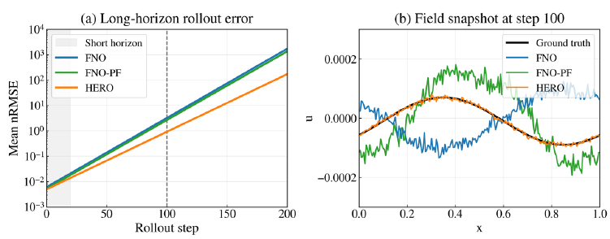
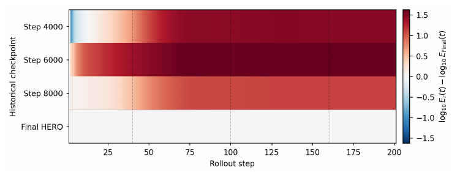
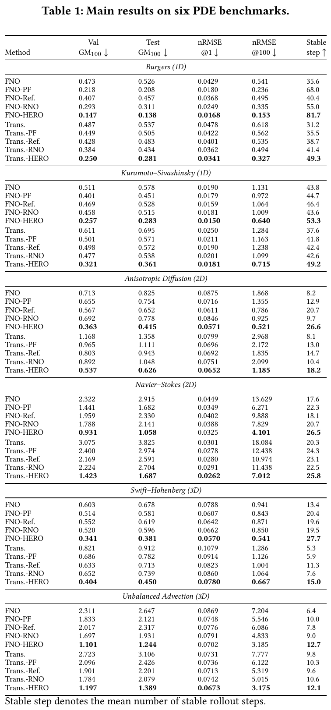

# HERO

**History-Enriched Rollout Training for Long-Horizon Autoregressive Neural Operators**

Jiaquan Zhang, Shuxu Chen, Haifan Meng, Yi Lu, Zhihan Lyu, Fan Mo, Wei Dong, Yang Yang, and Chaoning Zhang. [Paper](https://arxiv.org/abs/2607.29135)


HERO trains an autoregressive neural operator with a relative loss against a candidate failure rollout. The candidate pool contains a lagged operator rollout, a rollout from a perturbed input, and a detached current rollout. Rollout error, spectral error, energy error, and error growth determine which candidate supplies the reference. This repository implements HERO with an FNO backbone.

## Installation

The reference environment uses Python 3.13, PyTorch 2.6, and APEBench 0.1.1. Run the commands from the repository root in an active Python environment. APEBench generates reference trajectories on the CPU, and FNO training supports CPU and CUDA. [PyTorch installation](https://pytorch.org/get-started/previous-versions/#v260)

```bash
python -m pip install -r requirements.txt
```

## Quick start

Generate Burgers trajectories, train one FNO-HERO model, and evaluate its best validation checkpoint.

```bash
python -m data.generate --pde burgers
python train.py --pde burgers --device cuda
```

The default run uses seed 0 and writes to `runs/hero/burgers/seed_0/`. The directory contains the experiment configuration, validation-selected checkpoint, resumable checkpoint, test metrics, and per-trajectory rollout errors. Rerunning the same command resumes an interrupted run.

The CPU smoke run uses two trajectories per split and four optimizer steps. It exercises candidate selection and evaluates the resulting checkpoint.

```bash
python -m data.generate --pde burgers --smoke
python train.py --pde burgers --device cpu --smoke
```

## PDE data

Generate all nine datasets in `datasets/hero/` with the reference solvers. Each task uses 50 training trajectories of 51 frames, 10 validation trajectories of 201 frames, and 30 test trajectories of 201 frames. All grids are periodic and contain one scalar field. A 201-frame trajectory includes the initial condition and 200 reference steps. [APEBench](https://github.com/tum-pbs/apebench)

```bash
python -m data.generate --pde all
```

| Benchmark | `--pde` | Grid | Periodic extent per axis | Time step |
|---|---|---:|---:|---:|
| Dispersion | `dispersion` | 160 | 1 | 0.001 |
| Burgers | `burgers` | 160 | 1 | 0.1 |
| KdV | `kdv` | 160 | 2π | 0.01 |
| Kuramoto–Sivashinsky | `ks` | 160 | 60 | 0.1 |
| Anisotropic diffusion | `anisotropic_diffusion` | 64 × 64 | 1 | 0.1 |
| Kolmogorov flow | `kolmogorov_flow` | 64 × 64 | 2π | 0.1 |
| Decaying turbulence / Navier–Stokes | `navier_stokes` | 64 × 64 | 1 | 0.1 |
| Swift–Hohenberg | `swift_hohenberg` | 32 × 32 × 32 | 10π | 0.1 |
| Unbalanced advection | `unbalanced_advection` | 32 × 32 × 32 | 1 | 0.1 |

Pass any identifier in the table to `train.py --pde` to train its FNO. `--seed` controls model training. The data splits use fixed seeds 0, 1, and 773.

## Training protocol

The HERO preset uses five-step differentiable rollouts, a batch size of 20, and 10,000 AdamW updates. The learning rate warms up to 0.001 over 2,000 steps and then follows a cosine schedule. The relative loss starts at step 4,000. The lagged model refreshes every 2,000 steps, and the weight of the relative loss ramps from 0 to 0.02 over 2,000 steps. The margin is 0.02 and the softplus parameter is 5. The perturbation is band-limited noise scaled to 1% of the input RMS.

Validation GM100 selects a checkpoint. Test evaluation starts from the first frame and feeds predictions back into the FNO for 200 steps. GM100 is the geometric mean over the first 100 steps, averaged across trajectories. Stable step counts the consecutive prefix with nRMSE at most 0.1, capped at 100.

The FNO widths are 28, 20, and 4 for 1D, 2D, and 3D, respectively. The corresponding depths are 1, 1, and 5. This implementation uses dense Fourier weights. Its 2D FNO has 102,881 parameters. The 2D FNO in paper Table 8 has 30,541 parameters. [Backbone configurations](assets/paper/table-5.png) · [Computational cost](assets/paper/table-8.png)

Use `--microbatch` to limit GPU memory while keeping the effective batch size at 20.

```bash
python train.py --pde swift_hohenberg --device cuda --microbatch 5
```

## Long-horizon stability tuning

The stability preset warm-starts from a completed HERO run on KS, Swift–Hohenberg, or Unbalanced Advection. It extends the original training trajectories to 201 frames and uses 32 additional validation trajectories. Evaluation uses the HERO test split and 30 independently generated audit trajectories.

```bash
python -m data.generate --pde ks
python train.py --pde ks --device cuda
python -m data.generate --pde ks --preset stability
python train.py --pde ks --stage stability --device cuda
```

The tuning checkpoint is selected by 200-step validation rollouts. KS uses training-derived RMS and Fourier amplitude limits. Unbalanced Advection uses projections that preserve the mean and RMS or the Fourier amplitudes. Swift–Hohenberg uses exponential integration of known linear and reaction terms with a learned FNO correction. This preset saves its results under `runs/stability/`.

## Paper results

The table reproduces the published FNO-HERO means over five seeds. The commands above run a single seed.

| Benchmark | Val GM100 ↓ | Test GM100 ↓ | nRMSE@1 ↓ | nRMSE@100 ↓ | Stable step ↑ |
|---|---:|---:|---:|---:|---:|
| Dispersion | 0.091 | 0.097 | 0.0038 | 0.246 | 80.8 |
| Burgers | 0.147 | 0.138 | 0.0168 | 0.153 | 81.7 |
| KdV | 0.036 | 0.034 | 0.0049 | 0.919 | 60.6 |
| Kuramoto–Sivashinsky | 0.257 | 0.283 | 0.0150 | 0.640 | 53.3 |
| Anisotropic diffusion | 0.363 | 0.415 | 0.0571 | 0.521 | 26.6 |
| Kolmogorov flow | 0.477 | 0.565 | 0.2860 | 0.648 | 3.4 |
| Decaying turbulence / Navier–Stokes | 0.931 | 1.058 | 0.0325 | 4.101 | 26.5 |
| Swift–Hohenberg | 0.341 | 0.381 | 0.0570 | 0.541 | 27.7 |
| Unbalanced advection | 1.101 | 1.244 | 0.0702 | 3.185 | 12.7 |





<details>
<summary>Full paper tables</summary>



| Table | Content |
|---|---|
| [2](assets/paper/table-2.png) | Component ablations |
| [3](assets/paper/table-3.png) | Out-of-distribution generalization |
| [4](assets/paper/table-4.png) | PDE benchmark configurations |
| [5](assets/paper/table-5.png) | Backbone configurations |
| [6](assets/paper/table-6.png) | Relative-training start-step sensitivity |
| [7](assets/paper/table-7.png) | Lagged-operator refresh sensitivity |
| [8](assets/paper/table-8.png) | Computational cost |
| [9](assets/paper/table-9.png) | Complete 1D results |
| [10](assets/paper/table-10.png) | Complete 2D and 3D results |

</details>

## Repository layout

| Path | Purpose |
|---|---|
| `data/` | Benchmark parameters and reference trajectory generation |
| `model/fno.py` | Fourier neural operator |
| `model/hero.py` | Lagged reference selection and HERO loss |
| `model/stability.py` | Output constraints and physics-informed stability preset |
| `train.py` | Training, validation, checkpointing, and test evaluation |
| `assets/paper/` | Original figures and tables extracted from the paper |

## Citation

```bibtex
@article{zhang2026hero,
  title={HERO: History-Enriched Rollout Training for Long-Horizon Autoregressive Neural Operators},
  author={Zhang, Jiaquan and Chen, Shuxu and Meng, Haifan and Lu, Yi and Lyu, Zhihan and Mo, Fan and Dong, Wei and Yang, Yang and Zhang, Chaoning},
  journal={arXiv preprint arXiv:2607.29135},
  year={2026}
}
```

Related research code for PDE benchmarks and neural operators. [PDEBench](https://github.com/pdebench/PDEBench) · [NeuralOperator](https://github.com/neuraloperator/neuraloperator)
