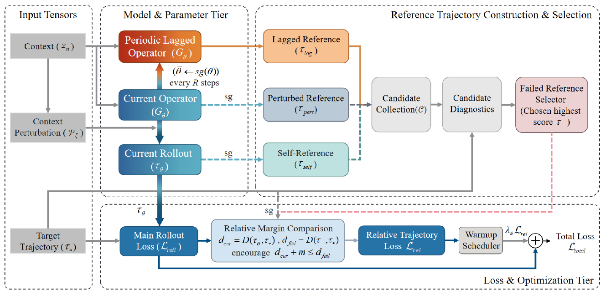

<h1 align="center">HERO</h1>

<p align="center">
  <strong>History-Enriched Rollout Training<br>for Long-Horizon Autoregressive Neural Operators</strong>
</p>

<p align="center">
  Jiaquan Zhang · Shuxu Chen · Haifan Meng · Yi Lu · Zhihan Lyu<br>
  Fan Mo · Wei Dong · Yang Yang · Chaoning Zhang
</p>

<p align="center">
  <a href="https://arxiv.org/abs/2607.29135"></a>
  <a href="requirements.txt"></a>
  <a href="https://github.com/tum-pbs/apebench"></a>
</p>

<p align="center">
  <a href="https://arxiv.org/abs/2607.29135">Paper</a> ·
  <a href="#quick-start">Quick Start</a> ·
  <a href="#benchmarks-and-data">Benchmarks</a> ·
  <a href="#training-and-evaluation">Training &amp; Evaluation</a> ·
  <a href="#citation">Citation</a>
</p>

<p align="center">
  <a href="assets/paper/figure-3.png">
    
  </a>
</p>
<p align="center">
  <em>HERO learns from lagged, perturbed-input, and current rollouts through a fixed failure reference. Click to enlarge.</em>
</p>

## Overview

Autoregressive neural operators repeatedly feed their predictions back as inputs, allowing local errors to accumulate over long trajectories. **HERO adds a comparison with the model's own failure behavior to ordinary ground-truth rollout supervision.**

For each training sample, HERO considers three detached candidates: a rollout from a periodically refreshed lagged operator, a rollout from a perturbed input, and the current rollout. It ranks them using rollout error, spectral discrepancy, energy error, and error growth, then uses the highest-scoring failure as a fixed reference in a margin-based relative objective.

This repository implements **FNO + HERO** on nine periodic PDE benchmarks in 1D, 2D, and 3D. It also includes a separate, optional stability-tuning stage for three benchmarks.

## Highlights

- **History-informed supervision.** A lagged operator supplies earlier failure behavior without storing every training checkpoint.
- **Multiple failure signals.** Candidate selection combines trajectory, spectral, energy, and error-growth diagnostics.
- **Unchanged HERO inference.** The relative objective changes training; the deployed HERO model remains the FNO backbone.
- **A complete experiment workflow.** Generate reference trajectories, train with resumable checkpoints, and evaluate free autoregressive rollouts through the supplied scripts.

## Installation

The reference environment documented for this repository uses **Python 3.13**. Dependencies are pinned in [`requirements.txt`](requirements.txt), including PyTorch 2.6.0, APEBench 0.1.1, JAX 0.5.3 (CPU), and NumPy 2.2.6.

```bash
git clone https://github.com/Alley123456/HERO.git
cd HERO

python3.13 -m venv .venv
source .venv/bin/activate
python -m pip install --upgrade pip
python -m pip install -r requirements.txt
```

Run the remaining commands from the repository root with this environment active. Reference data generation uses APEBench on the CPU by default. Training supports CPU and NVIDIA CUDA; `--device auto` selects CUDA when available and otherwise CPU. On macOS, use `--device cpu` (the CLI does not expose an MPS option). For a CUDA installation, choose the appropriate **PyTorch 2.6.0** build from the [official installation instructions](https://pytorch.org/get-started/previous-versions/#v260).

## Quick Start

Start with a small **CPU smoke run** to exercise data generation, HERO training, checkpoint selection, and test evaluation:

```bash
python -m data.generate --pde burgers --smoke
python train.py --pde burgers --device cpu --smoke
```

This uses two trajectories per split and four optimizer updates. It writes data to `datasets/hero_smoke/burgers/` and results to `runs/hero_smoke/burgers/seed_0/`, keeping the smoke run separate from full experiments. It is a workflow check, not a benchmark result.

For a full Burgers run:

```bash
python -m data.generate --pde burgers
python train.py --pde burgers --device auto --seed 0
```

Training automatically evaluates the best validation checkpoint on the test split. Results are saved to `runs/hero/burgers/seed_0/`.

## Benchmarks and Data

Datasets are generated locally with [APEBench](https://github.com/tum-pbs/apebench); no dataset download is required. Generate one task, several tasks, or all nine:

```bash
python -m data.generate --pde ks
python -m data.generate --pde burgers kdv
python -m data.generate --pde all
```

| Benchmark | `--pde` | Grid | Domain extent per axis | Time step |
| :--- | :--- | :---: | :---: | :---: |
| Dispersion | `dispersion` | 160 | 1 | 0.001 |
| Burgers | `burgers` | 160 | 1 | 0.1 |
| Korteweg–de Vries | `kdv` | 160 | 2π | 0.01 |
| Kuramoto–Sivashinsky | `ks` | 160 | 60 | 0.1 |
| Anisotropic diffusion | `anisotropic_diffusion` | 64 × 64 | 1 | 0.1 |
| Kolmogorov flow | `kolmogorov_flow` | 64 × 64 | 2π | 0.1 |
| Decaying turbulence / Navier–Stokes | `navier_stokes` | 64 × 64 | 1 | 0.1 |
| Swift–Hohenberg | `swift_hohenberg` | 32 × 32 × 32 | 10π | 0.1 |
| Unbalanced advection | `unbalanced_advection` | 32 × 32 × 32 | 1 | 0.1 |

All tasks use periodic grids and a single scalar field. The default HERO splits contain **50 training trajectories × 51 frames**, **10 validation trajectories × 201 frames**, and **30 test trajectories × 201 frames**. Frame counts include the initial condition. Data seeds are fixed at 0, 1, and 773; `train.py --seed` controls model training.

Each `datasets/hero/<pde>/` directory contains `train.npy`, `val.npy`, `test.npy`, and `metadata.json`. Arrays have shape `(trajectories, frames, *grid)` and dtype `float32`. Dataset generation reuses existing files after checking their metadata and array specifications. Use `--output` to choose a different data root and pass the same root to training with `--data-dir`.

## Training and Evaluation

### Training

Select any benchmark identifier from the table above. For example, after generating KS data:

```bash
python train.py --pde ks --device auto --seed 0
```

To reduce GPU memory usage, split the effective training batch into smaller pieces with `--microbatch`:

```bash
python -m data.generate --pde swift_hohenberg
python train.py --pde swift_hohenberg --device cuda --microbatch 5
```

The default HERO effective batch size remains 20. Rerun an interrupted command with the **same configuration** to resume from the latest saved checkpoint. When changing settings, use a separate `--out` directory; incompatible configurations are rejected. Rerunning a completed experiment prints its saved metrics.

<details>
<summary><strong>Default HERO protocol and available options</strong></summary>

| Setting | Value |
| :--- | :--- |
| Differentiable rollout length | 5 steps |
| Optimizer | AdamW; weight decay 0.01 |
| Optimizer updates / batch size | 10,000 / 20 |
| Learning rate | 0.001 peak; 2,000-step warmup, then cosine decay |
| Relative supervision | Starts at step 4,000 |
| Lagged-operator refresh | Every 2,000 steps after relative supervision starts |
| Relative-loss weight | Ramps from 0 to 0.02 over 2,000 steps |
| Margin / softplus beta | 0.02 / 5 |
| Input perturbation | Band-limited noise scaled to 1% of input RMS |
| Validation interval | Every 500 updates, and at the final update |
| FNO modes / width / depth | 1D: 28 / 28 / 1; 2D: 8 / 20 / 1; 3D: 8 / 4 / 5 |

Useful options include `--seed`, `--device`, `--data-dir`, `--out`, `--threads`, `--steps`, `--eval-every`, and `--microbatch`. See the full interfaces with:

```bash
python -m data.generate --help
python train.py --help
```

</details>

### Evaluation and Outputs

Evaluation is built into [`train.py`](train.py). In the HERO stage, **validation GM100** selects the best checkpoint using 100-step rollouts. After training, that checkpoint runs **200-step free autoregressive test rollouts**, starting from the first reference frame and feeding predictions back into the model. The CLI does not provide a standalone evaluation-only flag.

| Output | Contents |
| :--- | :--- |
| `config.json` | Experiment settings, dataset metadata, and PyTorch version |
| `last.pt` | Latest resumable training state, including optimizer and random states |
| `best.pt` | Validation-selected model and its configuration, written after training |
| `metrics.json` | Selected step, parameter count, validation metrics, and test metrics |
| `test_errors.npy` | Per-trajectory nRMSE for each of the 200 prediction steps |

**GM100** is the geometric mean of nRMSE over the first 100 prediction steps, averaged across trajectories. **Stable step** is the length of the consecutive initial prefix with nRMSE ≤ 0.1, capped at 100. Test outputs also include nRMSE at steps 1, 100, and 200, mean nRMSE over 200 steps, stability through step 200, and the number of trajectories that exceed nRMSE 10 at any step. Lower errors and longer stable prefixes are better.

### Optional Stability Tuning

This additional stage is available for `ks`, `swift_hohenberg`, and `unbalanced_advection`. It uses longer training trajectories and task-specific output constraints or a physics-informed integration step. **It changes the rollout model and data protocol, so report its results separately from the standard HERO stage.**

After completing a HERO run, generate the corresponding stability data and start tuning:

```bash
python -m data.generate --pde ks
python train.py --pde ks --device auto --seed 0
python -m data.generate --pde ks --preset stability
python train.py --pde ks --stage stability --device auto --seed 0
```

By default, tuning reads the matching seed's HERO checkpoints from `runs/hero/ks/seed_0/` and saves to `runs/stability/ks/seed_0/`. Use `--warm-start` to point to a different HERO run directory.

<details>
<summary><strong>Stability data, constraints, and model selection</strong></summary>

- Training uses 50 trajectories of 201 frames, extending the original HERO training trajectories, plus a separate validation split of 32 trajectories.
- Evaluation uses the original HERO test split and 30 independently generated audit trajectories. Audit outputs are saved as `audit_errors.npy` and an `audit` entry in `metrics.json`.
- KS uses training-derived RMS or Fourier amplitude limits. Unbalanced advection uses mean/RMS or Fourier amplitude preservation. Swift–Hohenberg combines exponential integration of known terms with a learned FNO correction; its correction output layer is reset at initialization.
- Checkpoint selection uses a composite score from 200-step validation rollouts: mean nRMSE + 0.25 × final-step nRMSE + 0.25 × (1 − stable steps / 200).

</details>

## Paper and Reproduction Notes

The [paper](https://arxiv.org/abs/2607.29135) studies both spectral and attention-based backbones. **This repository contains the FNO implementation.** The commands above run one training seed and are not a claim of exact reproduction of every paper result.

In particular, the dense Fourier weights in [`model/fno.py`](model/fno.py) give the current 2D FNO **102,881 parameters**, while [paper Table 8](assets/paper/table-8.png) reports **30,541**. Keep this difference in mind when comparing accuracy or computational cost. The paper figures and tables below are reference material, not measurements produced by the quick-start commands.

<details>
<summary><strong>Browse paper figures and tables</strong></summary>

| Asset | Content |
| :--- | :--- |
| [Figure 1](assets/paper/figure-1.png) | Rollout errors and field predictions |
| [Figure 2](assets/paper/figure-2.png) | Relative rollout-error landscape across checkpoints |
| [Figure 3](assets/paper/figure-3.png) | HERO training overview |
| [Table 1](assets/paper/table-1.png) | Main results on six PDE benchmarks |
| [Table 2](assets/paper/table-2.png) | Component ablations |
| [Table 3](assets/paper/table-3.png) | Out-of-distribution generalization |
| [Table 4](assets/paper/table-4.png) | PDE benchmark configurations |
| [Table 5](assets/paper/table-5.png) | Backbone configurations |
| [Table 6](assets/paper/table-6.png) | Relative-training start-step sensitivity |
| [Table 7](assets/paper/table-7.png) | Lagged-operator refresh sensitivity |
| [Table 8](assets/paper/table-8.png) | Computational cost |
| [Table 9](assets/paper/table-9.png) | Complete 1D results |
| [Table 10](assets/paper/table-10.png) | Complete 2D and 3D results |

</details>

## Project Structure

```text
HERO/
├── assets/paper/       # Paper figures and tables
├── data/
│   ├── benchmarks.py   # PDE parameters and split definitions
│   └── generate.py     # APEBench reference trajectory generation
├── model/
│   ├── fno.py          # 1D, 2D, and 3D Fourier neural operator
│   ├── hero.py         # Candidate selection and relative rollout loss
│   └── stability.py    # Optional constraints and integration wrappers
├── requirements.txt   # Pinned dependencies
├── train.py           # Training, validation, checkpointing, and evaluation
├── datasets/          # Generated locally
└── runs/              # Generated checkpoints and evaluation outputs
```

## Citation

If HERO is useful in your research, please cite the [arXiv preprint](https://arxiv.org/abs/2607.29135):

```bibtex
@article{zhang2026hero,
  title   = {{HERO}: History-Enriched Rollout Training for Long-Horizon Autoregressive Neural Operators},
  author  = {Zhang, Jiaquan and Chen, Shuxu and Meng, Haifan and Lu, Yi and Lyu, Zhihan and Mo, Fan and Dong, Wei and Yang, Yang and Zhang, Chaoning},
  journal = {arXiv preprint arXiv:2607.29135},
  year    = {2026},
  doi     = {10.48550/arXiv.2607.29135},
  url     = {https://arxiv.org/abs/2607.29135}
}
```

## Acknowledgments

This implementation uses [PyTorch](https://pytorch.org/) for neural operator training and [APEBench](https://github.com/tum-pbs/apebench) for reference PDE trajectories.
